# Changelog

Notable changes to Drum Evaluator, newest first.

## 2026-10-16

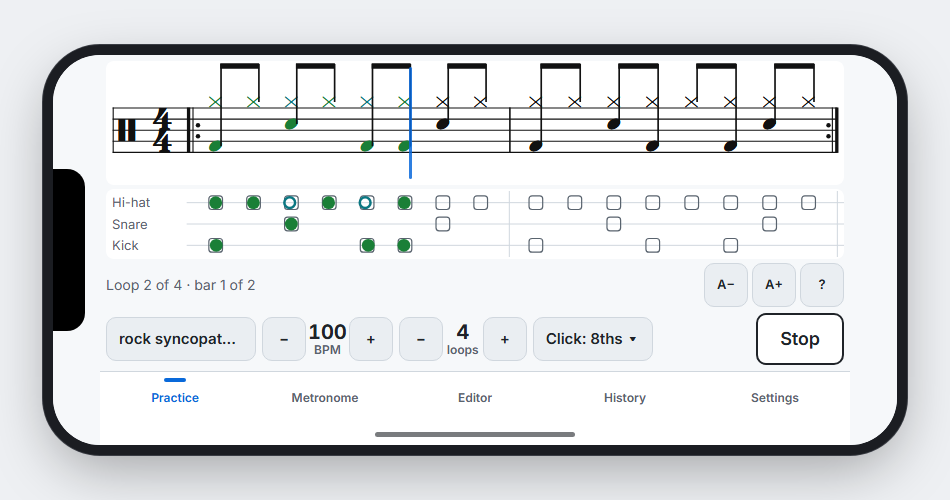

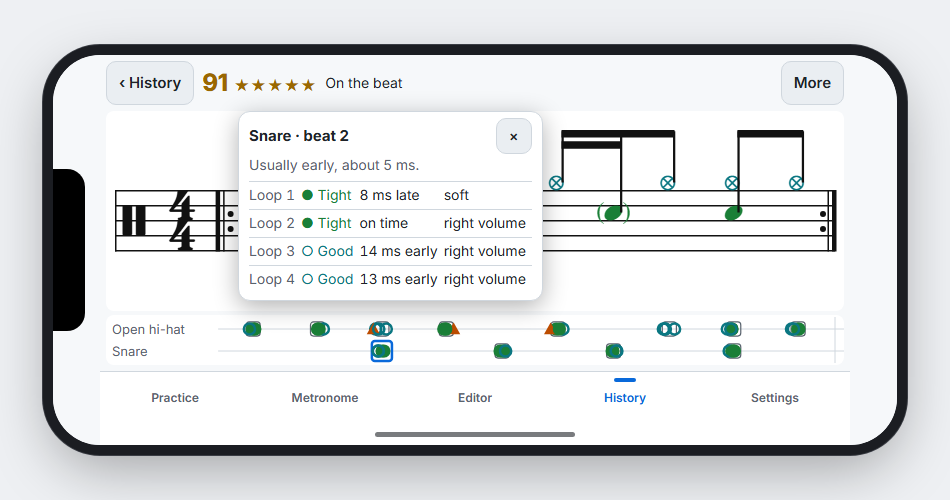

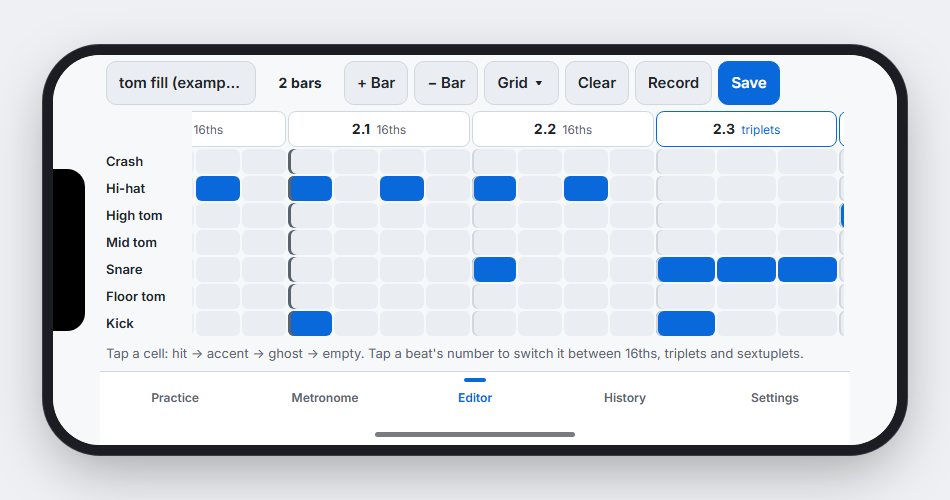

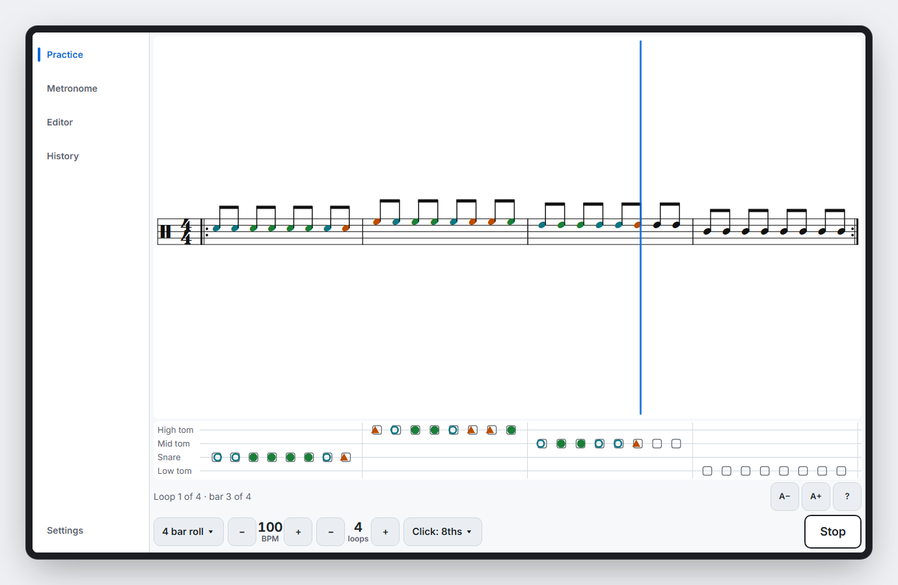

- **First design for phones.** A clickable mock-up of the phone app at
  real iPhone and Android sizes, to settle the layout before the real
  screens are built. The hits in it come from a pretend drummer. What it
  settles so far:
  - **Practice** is sideways on a stand: two bars of notation coloured as
    you play, the timeline underneath, and one row of controls along the
    bottom. Grooves that fit stay still; longer ones move on.
  - **After a session** you go straight to the review: score and stars at
    the top, every note coloured; tap one for its loops (timing, volume,
    grade). The full summary is one tap away.
  - **Groove Editor** sideways, all bars in one row that scrolls, each
    beat in 16ths, triplets or sextuplets, recording on the same screen.
  - **Metronome** upright or sideways, with clicks per beat (1 to 8), any
    time signature, and polyrhythm tracks set from a small menu (beats,
    clicks per beat, pitch).
  - **Practice click** can be off, beats, 8ths, triplets or 16ths.
  - **Pads**: learning one fills the screen so you can read it from the
    kit; pads already learned are green with a tick.
  - **Navigation**: five buttons along the bottom (Practice, Metronome,
    Editor, History, Settings); a sidebar on desktop.
  - **Colour-blind friendly**: each grade has a shape in the timeline.
  - **Light and dark**, following your device's setting.
  - **Desktop**: zoom the music with Ctrl + mouse wheel to fit more bars;
    a narrow window behaves like a phone.

## 2026-10-15

- **Calibrate window: three ways to measure your setup's delay**, each
  labelled with how far it can be trusted, and each kit remembers which
  one it uses:
  - **Tap along** at a tempo you choose (40-99 BPM). No numbers are shown
    during a take, so they can't sway you, and it only saves once two
    takes agree within 10 ms. Practising 20+ BPM away from that tempo
    adds a note to the status line.
  - **Microphone**: measures the delay with your mic, without your own
    timing getting in the way (about ±5 ms). It won't save from too few
    or too uneven measurements.
  - **Your kit's own metronome**: play along to it instead of the app's
    click. The app lines its grid up with your playing afterwards, scores
    the session "timed against your own average", and keeps separate
    personal bests for it.
- **Fixed: the click sometimes failed to start** ("Unanticipated host
  error"), seen after Windows updates. This also broke the microphone
  calibration.
- **Fixed: microphone calibration read about 28 ms too high** on some
  setups, which could make on-time hits score as misses.
- **Notation for phones: a new notation engine tried out.** It can ship in
  every app store, and it passed a first test drawing grooves with ghost
  notes, accents, open hi-hats, triplets, sextuplets and two voices.

## 2026-10-13

- **A score for every session.** A 0-100 score and 0-5 stars at the end
  of each play-along:
  - Timing: each note earns points by how close it landed (tight, good,
    loose, off); missed notes and extra notes earn none.
  - Volume counts for a fifth of the score, for the drums you've asked it
    to check. Ticking or unticking a drum's volume afterwards updates the
    score.
  - Your personal best for each groove at each tempo: "New best! (was
    82)", your first score, or your best so far. Sessions stopped early
    don't count, and a built-in groove and your own copy keep separate
    bests.

## 2026-10-12

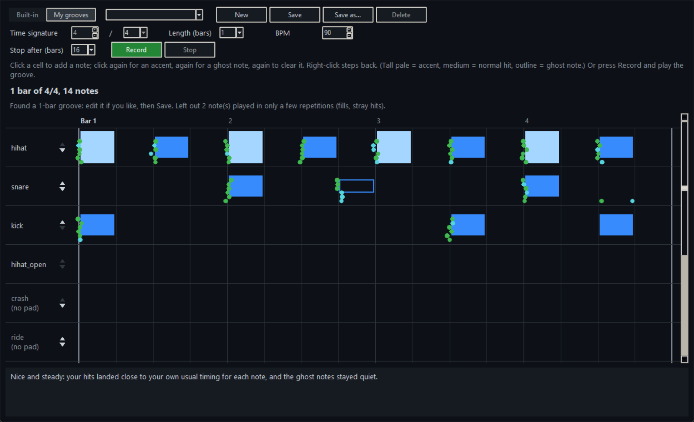

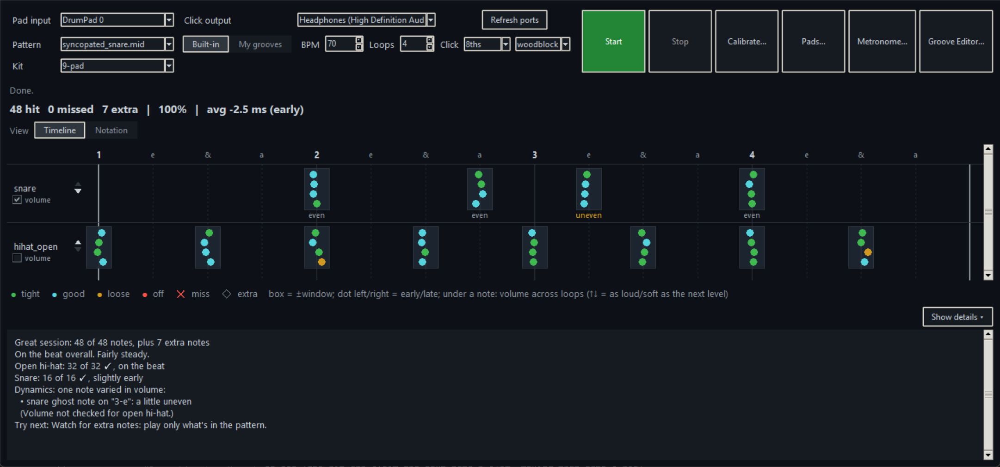

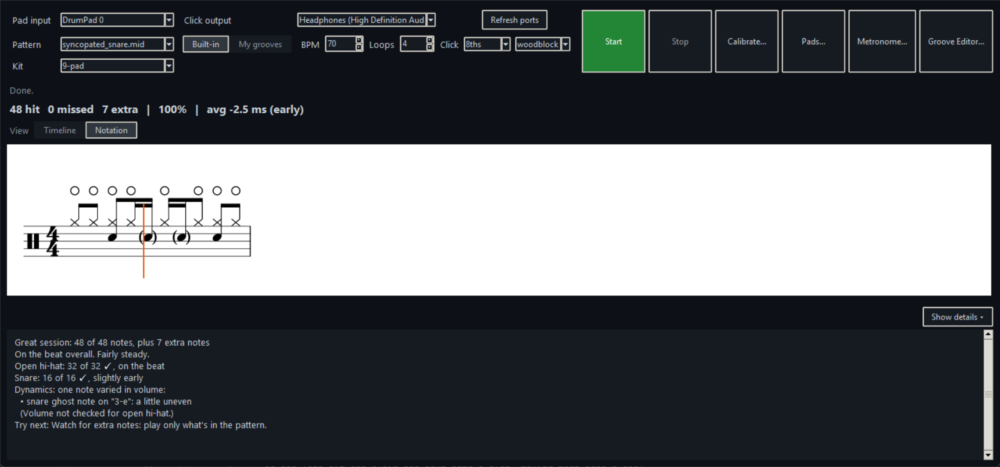

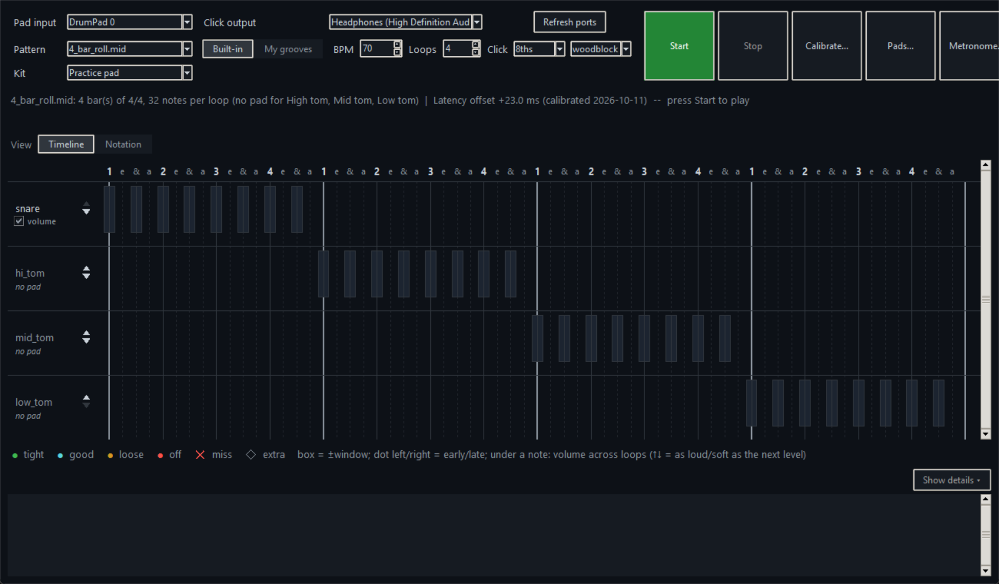

- **Groove Editor.** The Pattern detector became the Groove Editor: one
  place to make and change grooves. In the main window, the "Pattern
  detector..." button is now "Groove Editor...".
  - Click notes in: each click steps a cell through normal hit, accent,
    ghost note and empty; right-click steps back.
  - Or play them in: Record works like the Pattern detector did, and
    the groove it finds is ready to edit.
  - Set the length (1 to 4 bars), tempo and time signature.
  - You're asked before unsaved changes are lost.
- **Built-in and My grooves**, listed apart with a switch in both
  windows. Built-in grooves can't be changed or deleted: saving one makes
  your own copy, which can keep the same name.
- **Every drum in a pattern is shown.** Drums your kit has no pad for
  used to be dropped, which could cut a 4-bar pattern down to 1 bar. Now
  they're shown, marked "no pad", but not scored, and Start tells you
  which ones before you play.
- **Three toms read as three toms.** Patterns using the high, mid and
  low tom notes (General MIDI 50, 48 and 45) no longer show two of them
  as the same drum.
- **Notation fits the window.** The whole groove is drawn to fit, with
  no scroll bar, and switching to Notation no longer makes the window
  grow.
- **Triplets and sextuplets** (added later the same day):
  - The timeline's grid follows each beat's notes: 16ths ("1 e & a"),
    triplets ("1 trip let") or sextuplets, so fast notes no longer merge
    into one block.
  - The Groove Editor has a grid per beat: click a beat's number to
    switch it between 16ths, triplets and sextuplets, or set every beat
    at once. A beat whose notes wouldn't fit keeps its grid, so no notes
    are lost.
  - Notation writes quarter-note triplets across two beats under one
    bracket.
  - The summary names triplets the way drummers count them ("1-trip",
    "1-let").

## 2026-10-11

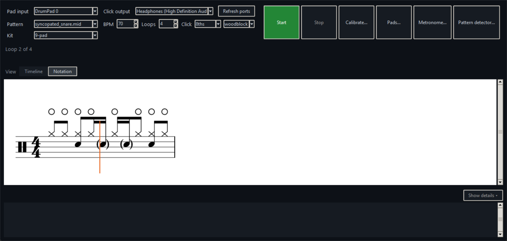

- **Drum notation view.** A Timeline / Notation switch in the main window
  shows the groove as real drum notation, engraved by Verovio, an
  open-source music engraving library: x noteheads for cymbals, kick and
  hi-hat on shared stems, ghost notes in parentheses, accents, triplets,
  and the "o" over open hi-hats, with the "o"s and accents kept in
  straight rows. Lines break to fit the window.
- **Playhead on the notation.** While you play, an orange line moves
  across the music, touching each note's left edge as it comes due and
  moving to the next line at a line break.
- **Any pattern works with any kit.** Pattern files are read the standard
  way whatever kit you've set up, so re-learning a pad can no longer make
  a drum vanish from a pattern (this happened with the hi-hat). On a
  practice pad, an open hi-hat note counts when you hit the hi-hat pad.
- **Volume checked for every groove.** Notes a drum always plays at the
  same volume (common in grooves saved from the pattern detector) are now
  checked for evenness too. Notes stuck at the pad's maximum volume are
  flagged, because they can't be told apart.
- **Sturdier settings.** If the kit settings file is damaged, the app
  still opens, says so, and keeps the damaged file as a backup.
- Saved grooves keep every drum you played, even if you switch kits
  before saving.

## 2026-10-07

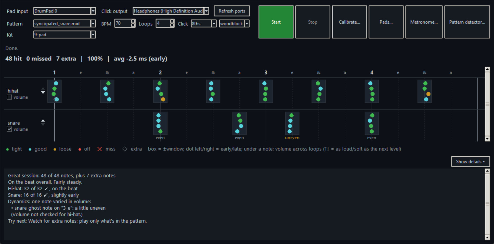

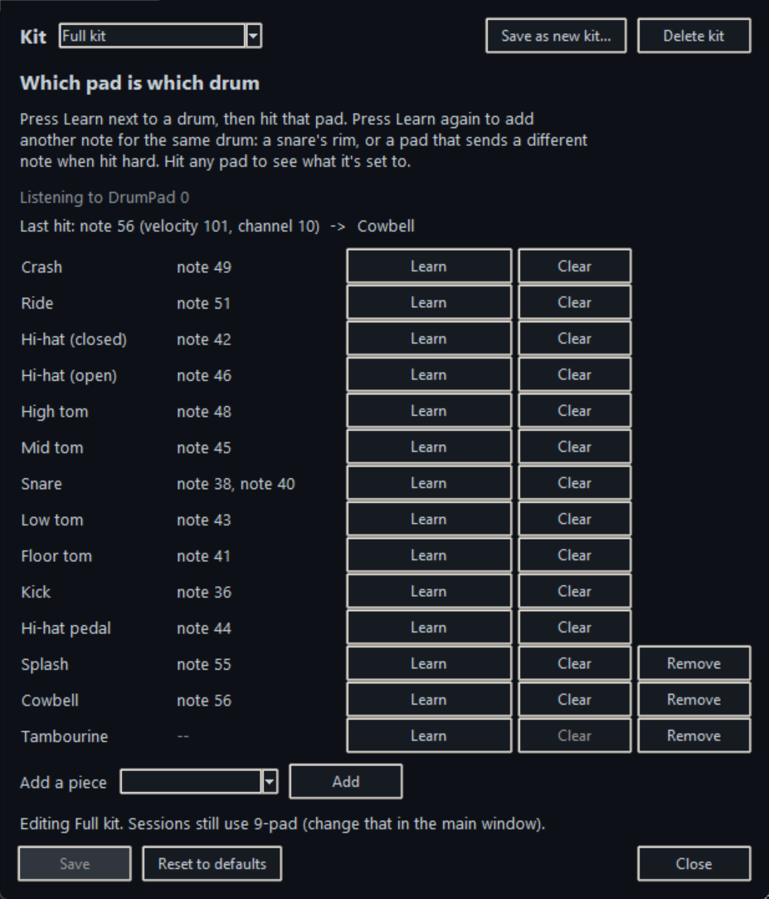

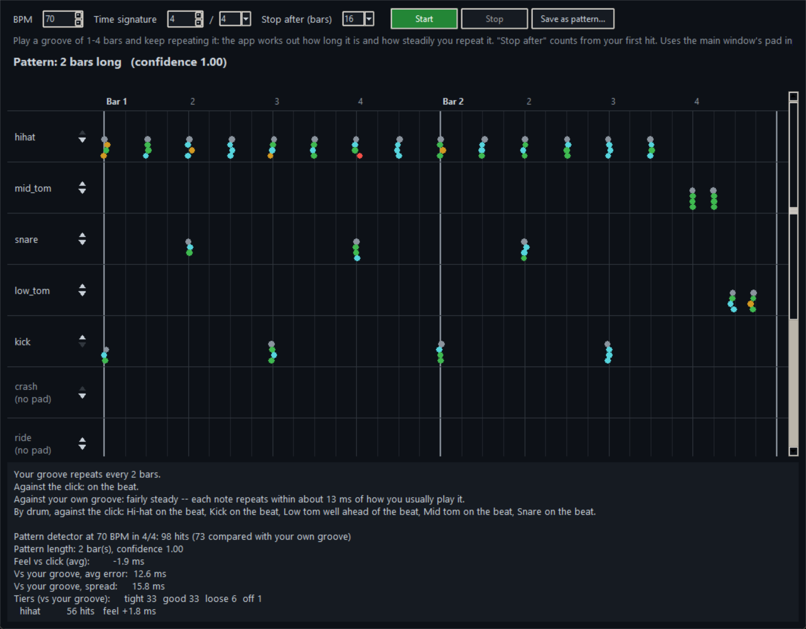

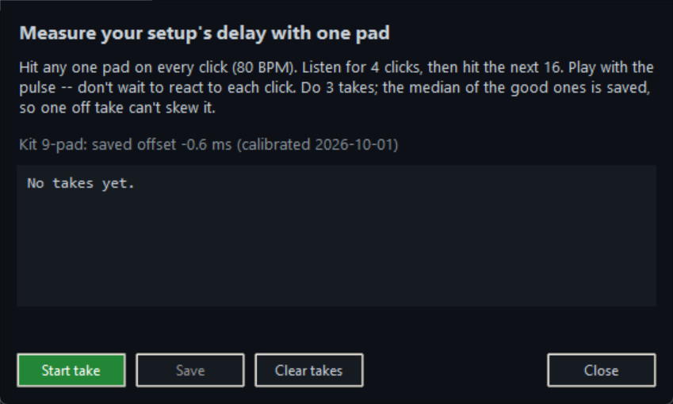

- **Pads window: set up pads by hitting them.** Press Learn next to a
  drum and hit the pad. Learn again to add another note for the same
  drum (a rim, or a pad that sends a different note when hit hard). A
  note taken from another drum moves, with a message. "Last hit" shows
  what any pad is set to.
- **Your own pieces.** Add a splash, china, cowbell, second snare and so
  on, from a list or by name; remove them again.
- **Saved kits.** Name your kits (no built-in names) and switch between
  them in the main window; each keeps its own pads, pieces and
  calibration, and the status line says when it was last calibrated. In
  the Pads window: pick which kit to edit, save as a new kit, delete a
  kit, or reset to a clean start (kick, snare and hi-hat only).
- **Room for big kits.** The main window and the pattern detector resize,
  their grids scroll, and up/down arrows reorder the drum rows (saved
  with the kit).
- **Pattern detector:**
  - **Save as pattern**: keep the groove you played as a pattern to play
    along to; fills and stray hits are left out, your usual dynamics kept.
  - Every piece of the kit is listed; after a recording, the drums you
    played move to the top.
  - "Stop after" counts from your first hit, so a slow start doesn't cut
    the groove short.
  - Fixed: the pattern's bars could come out in the wrong order if you
    rested a bar after the count-in.
  - Fixed: switching kits now updates its list of drums straight away.

## 2026-10-05

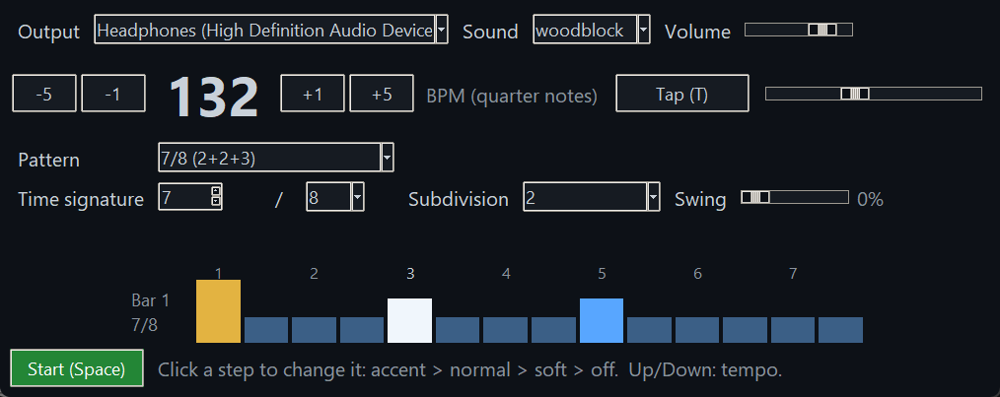

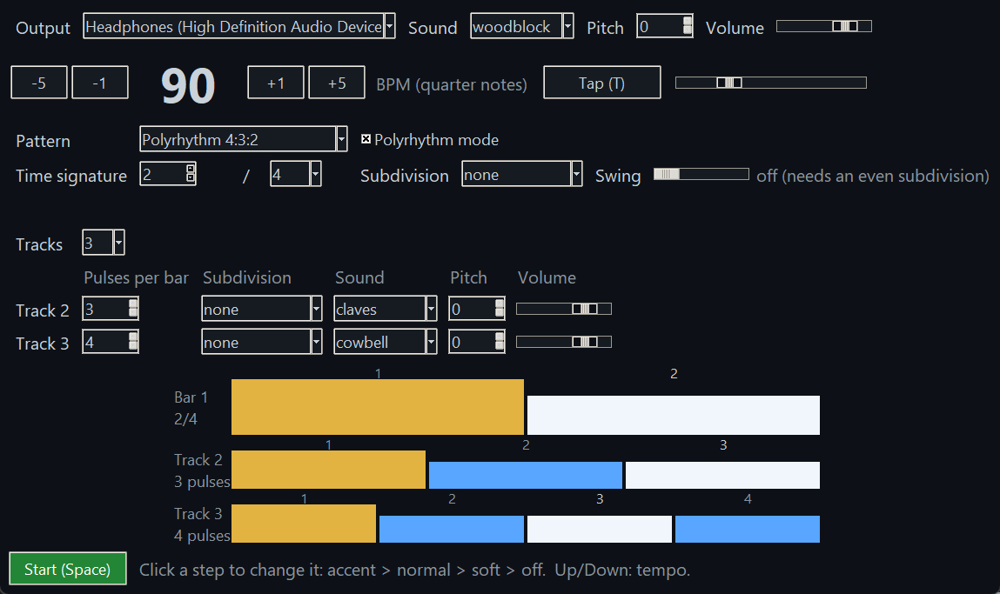

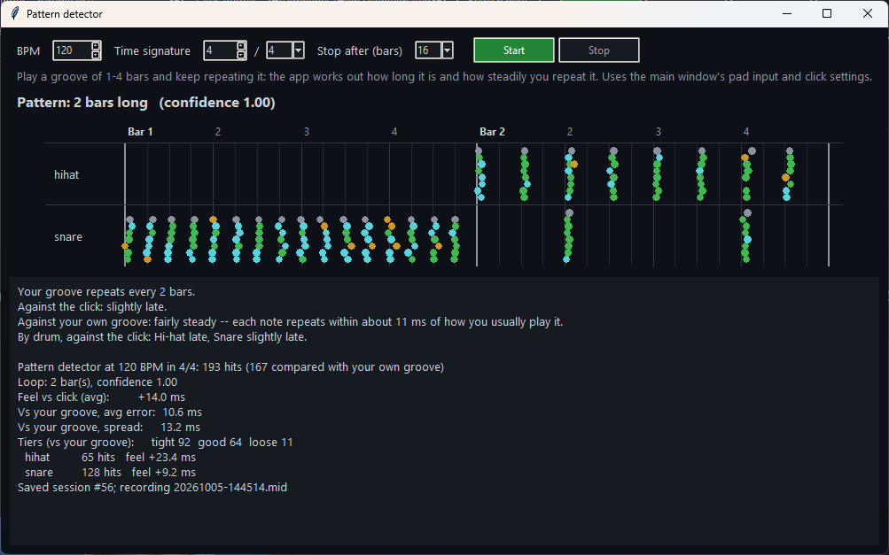

- **Pattern detector.** Play a groove of 1 to 4 bars to the click, no
  pattern file needed, and keep repeating it. The app works out how many
  bars it is, shows every hit on a grid of the pattern as you play, and
  sums up how steady you were against the click and against your own
  groove, drum by drum. Open it with the new Pattern detector... button.
- **The metronome starts faster:** about 0.1 s from Start to the first
  click, down from about 0.35 s.

- **Standalone metronome.** A full metronome that works on its own, no
  kit needed. Set the tempo with buttons, a slider, the arrow keys or tap
  tempo. Use any time signature, add subdivisions from 8ths to
  quintuplets and sextuplets, and dial in swing from 0% (straight) to
  100%.
- **Built-in click patterns.** 2/4 through 13/8 (odd meters ready-grouped,
  e.g. 7/8 as 2+2+3 or 3+2+2), swing 8ths and 16ths,
  son, rumba and bossa nova clave, and polyrhythms.
- **Polyrhythm mode.** Up to four click tracks at once, each spreading
  its own number of pulses over the bar (3 against 2, 5 against 4, or
  4:3:2 on three tracks), with its own sound, pitch and volume so you can
  hear each rhythm. Turn the mode off to go back to the first track.
- **Pitch for every click sound.** Shift any click up or down by up to an
  octave, so the four sounds become many.
- **Open the metronome from the main window**, with the new
  Metronome... button.
- **Edit the click step by step.** Click any step to make it an accent,
  normal, soft or silent. Your accents stay when you change the
  subdivision. Tempo and step changes are heard right away;
  a new time signature starts at the next bar line.
- **Scoring checked against research.** The timing grades and the words
  in the summary were compared with published studies of drummers'
  timing. The current thresholds hold up: for example, "very steady"
  matches the consistency of professional drummers. The comparison also
  found two improvements now on the roadmap: judging each drum's
  steadiness against its own feel (pros naturally play kick and snare a
  touch ahead of the hi-hat), and fewer false misses at fast tempos.
- **Plans for Mac, iPhone/iPad and Android.** The app is being organized
  so one shared scoring engine runs on all four platforms, so the same
  playing gets the same score everywhere.
- **Fixed: the click no longer takes over your sound output.** Music,
  lesson videos and screen recorders (like OBS) now work while it plays.
  If you've calibrated before, calibrate once more: the app reminds you,
  because the sound now takes a slightly different route to your
  speakers.

## 2026-10-01

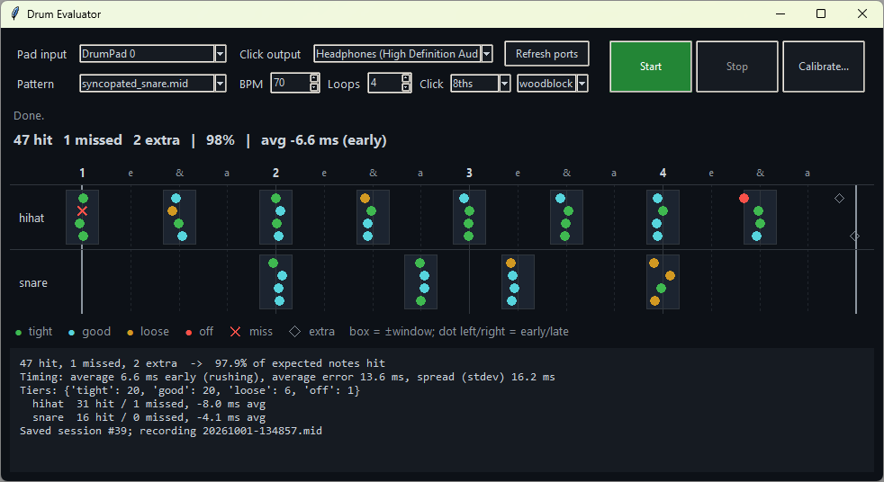

- **Dynamics feedback.** How evenly each note of the groove is played
  across loops, compared only with its own repeats (the snare on 2 with
  other snares on 2), and whether ghost notes stay quiet and accents stand
  out. Shown live under each note on the timeline.
- **Works with any velocity curve.** Pads offer different curves for
  turning hit strength into volume. Dynamics are judged in a way that gives
  the same answer whichever curve your pad uses.
- **Plain-language summary.** Results now read like a teacher's notes:
  how it went, timing in words, uneven notes by where they fall in the bar
  ("snare ghost note on 2-a"), and one "Try next" suggestion. The detailed
  numbers are behind a **Show details** button.
- **Volume feedback per drum.** A checkbox on each drum's row turns its
  volume feedback on or off. Cymbals start off, since their volume rarely
  matters and would clutter the feedback.
- **New click engine.** The metronome now plays directly through the sound
  card, timed to the exact sample. The click's own delay is compensated
  automatically, so calibration only has to measure the player and the pad.
- **Clearer calibration.** Calibration only sounds the clicks you're meant
  to hit. Extra in-between clicks made it easy to follow the wrong ones.
- Timing that's *off* now shows in red in the timeline.
- Fixes in free-play loop detection and in re-scoring saved recordings.

## 2026-09-30

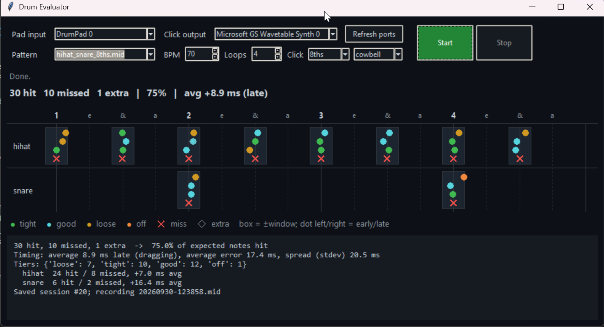

- **Desktop app.** Pick a pattern, tempo and loops, then watch each hit
  land on a live timeline, with a summary at the end. A pattern preview
  shows when you select one.
- **Calibration in the app**: hit any one pad along with the click. Several
  takes are combined so one off take can't skew the result.
- **First successful live run**: every note of a syncopated groove with
  ghost notes was detected and scored on a real drum pad.
- Play-along sessions with live scoring, a count-in, and an adjustable
  click (beats, 8ths, triplets, 16ths).
