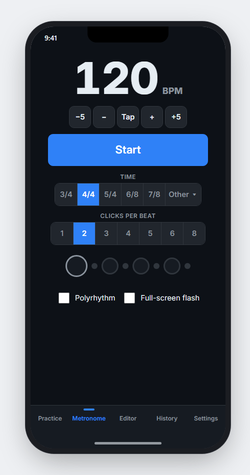
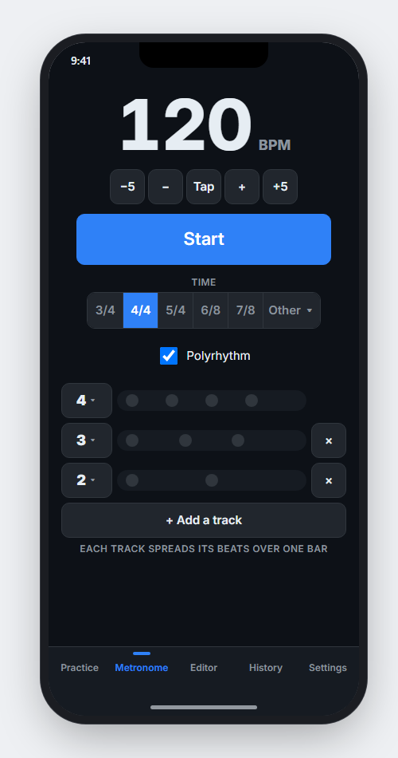
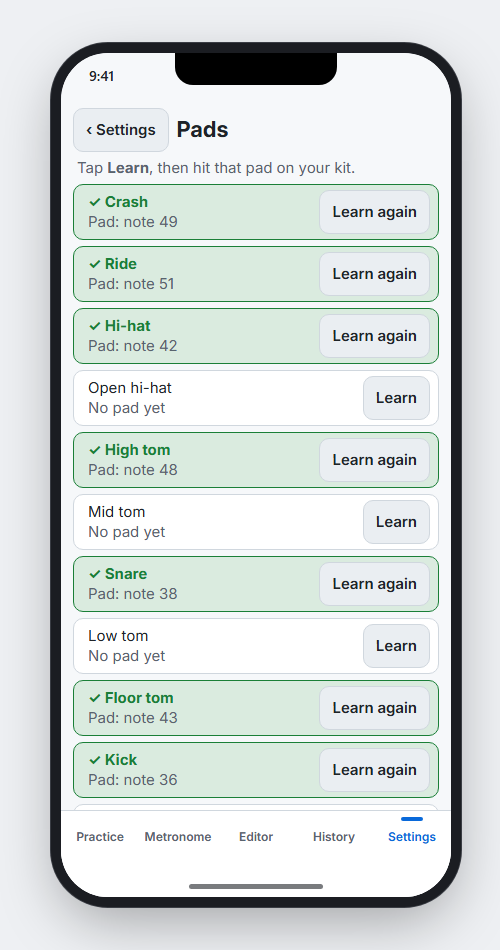

# Drum Evaluator

A real-time drum practice tool. Play along to a groove on an electronic kit
or drum pad, and it shows how close each hit landed: early, late, or right
on, as you play.

> **Status: early prototype, in active development.** The source code is
> private for now. This page is for following progress, the roadmap, and
> giving feedback.

*After a 4-loop session on a syncopated groove: each dot is one hit, placed
left or right of the beat by how early or late it was, and colored by how
close it landed. Under each snare note: whether its volume stayed even
across the loops. Below: the session summary in plain words. Top left:
the pattern picker, with a switch between the built-in grooves and your
own, and the kit picker. The arrows next to each drum reorder the rows;
"Groove Editor..." (top right) opens the editor.*

## What it does today

- **Play along to a pattern.** Load a groove (a standard `.mid` file,
  e.g. exported from Guitar Pro or a DAW), set the tempo and number of loops,
  and play along to a count-in and click. Built-in grooves and your own
  are listed separately (a Built-in / My grooves switch). Any pattern
  works with any kit: drums your kit has no pad for are still shown
  (marked "no pad") but not scored, and Start tells you which ones; on a
  practice pad an open hi-hat note counts when you hit the hi-hat pad.
- **Live feedback on every hit.** Each note is scored as you play: hit,
  missed, or extra. Hits are graded from *tight* to *off* by how far from
  the beat they landed, in milliseconds.
- **Timeline view.** A one-bar timeline with a row per drum shows where
  each hit landed against where it should have, loop by loop.
- **Drum notation view.** Switch from the timeline to the groove as real
  sheet music (engraved by a proper notation engine, not drawn by hand):
  x noteheads for cymbals, ghost notes in parentheses, accents, triplets,
  and the "o" over open hi-hats. The whole groove is always in view, no
  scrolling. While you play, a line moves across the music and touches
  each note as it's due.
- **Dynamics.** Checks how evenly you play each note of the groove from
  loop to loop, and whether your ghost notes stay quiet and your accents
  stand out. Each note is only compared with its own repeats, so a ghost
  note is judged as a ghost note and an accent as an accent. Works with any
  pad velocity curve, so you don't need to change your pad's settings, and
  also checks grooves where every hit on a drum is meant to be the same
  volume. Volume feedback can be switched off per drum (cymbals start off).
- **Feedback in plain language.** After each session: how it went, your
  timing and each drum in words, which notes weren't even, and one thing to
  work on next. The full numbers are one click away.
- **Set up your pads by hitting them.** In the Pads window, press Learn
  next to a drum and hit the pad: done, no settings files. Pads that send
  a different note for the rim or a hard hit can be given both. Add your
  own pieces (splash, china, cowbell, a second snare, ...) from a list or
  by name.
- **Saved kits.** Name and keep several kits (say, a practice pad and a
  full e-kit), each with its own pads and calibration, and switch between
  them from the main window: no recalibrating when you switch back.
- **Latency calibration.** A short "hit any pad along with the click" test
  measures your setup's delay, so on-time playing scores as on time.
- **Sample-accurate click that shares your audio.** Play music or a
  lesson video alongside it, or record your screen with sound.
- **Standalone metronome.** Use it on its own, no kit needed: tap tempo,
  any time signature, subdivisions, swing (0-100%), and built-in
  patterns from 2/4 to 13/8 (odd meters ready-grouped, e.g. 7/8 as
  2+2+3 or 3+2+2), and clave. Click any step to accent it, soften it or
  mute it. Every sound can be pitched up or down.
- **Polyrhythms.** Up to four click tracks at once (3 against 2, 5
  against 4, 4:3:2, ...), each with its own sound, pitch and volume.
- **Groove Editor.** Make and change grooves two ways, on one grid:
  - **Click them in**: click a cell to add a note, click again for an
    accent, again for a ghost note, again to clear it (right-click steps
    back). Set the length (1 to 4 bars), tempo and time signature.
  - **Play them in**: press Record, play a groove of 1 to 4 bars to the
    click and keep repeating it. The app works out how long it is, plots
    every hit as you play, and scores how steadily you repeat your own
    groove, so a laid-back or pushed feel counts as long as it's
    consistent. The groove it finds (fills and stray hits left out, your
    usual dynamics kept) is ready to tidy up by clicking, then save.

  Volumes are ghost note / normal / accent, not numbers, so editing will
  work the same for acoustic drums later. Built-in grooves are never
  changed: saving one keeps your version as a copy in My grooves. You're
  asked before unsaved changes are lost.
- **Room for big kits.** The windows resize, the grids scroll, and you
  can reorder the drum rows to suit how you read them.
- **Session history.** Every session's results are saved.
- **Runs entirely on your computer.** No account, no internet connection,
  nothing uploaded.

*The same session in Notation view: the groove as sheet music, with the open
hi-hat "o" marks in a straight row and the ghost notes in parentheses.
The orange line moves across the music as you play, touching the left
edge of each note as it's due; here it's on the ghost note on "2-a".*

*The metronome playing a 4:3:2 polyrhythm: the main track's 2 beats,
against 3 and 4 evenly spaced pulses on two more tracks, each with its
own sound. Taller boxes are louder; white boxes are the clicks being
heard.*

*The Groove Editor just after recording a 1-bar groove: hi-hat 8ths with
accents on the beats, snare on 2 and 4 with a ghost note on "2-a", kick
on 1 and "3&". Each note of the groove found is a cell: tall and pale for
an accent, medium for a normal hit, an outline for a ghost note. The dots
are the hits you played, one per repetition. A short snare fill played
only once was left out; the kick on "4&" was added afterwards by
clicking. Save keeps it in My grooves.*

*The Pads window, editing a full kit: hit a pad after pressing Learn to
assign it. "Last hit" shows what any pad is set to (here, the cowbell).
The kit picker at the top chooses which kit to edit, separately from the
kit you play with.*

**Works with:** Windows today, plus any electronic kit or drum pad that
sends MIDI over USB. Mac, iPhone/iPad and Android versions are planned.

## Coming to phones: the first design

The app is being rebuilt to run on iPhone, Android and Mac as well as
Windows. Before the real screens are built, their layout is being worked
out in a clickable mock-up at real phone sizes, from the small iPhone SE
to the largest Pro Max. The pictures below come from that mock-up: the
hits in them are played by a pretend drummer, not scored from a real kit.

- **Practise with the phone sideways on a stand.** Two bars of notation,
  each note turning the colour of how close you hit it, and the timeline
  underneath. The controls sit in one row along the bottom, every button
  big enough to tap from the kit. Grooves that fit on screen stay still;
  longer ones move on as you play.
- **Straight to the review when you finish.** Your score and stars sit at
  the top, with every note of the groove coloured by how it went over all
  the loops. Tap a note to see each loop: how early or late, how loud,
  and its grade. "More" opens the full summary in words.
- **The Groove Editor goes sideways too,** with each beat on its own grid
  (16ths, triplets or sextuplets) and recording on the same screen.
- **Metronome upright or sideways:** clicks per beat, any time signature,
  and polyrhythms with each track's beats, subdivision and pitch set from
  a small menu.
- **Set up pads from across the room:** after "Learn", the screen says
  which pad to hit in big letters, then shows a large tick. Pads already
  set up are shown green with a tick.
- **Easy to read for colour-blind players:** every grade has its own
  shape in the timeline as well as its colour.
- **Light and dark,** following your phone's own setting.
- **The same design on a computer,** with a sidebar instead of the bottom
  buttons. Zoom the music in or out (Ctrl + mouse wheel) to fit more bars.

*Practising on an iPhone held sideways, partway through a 2-bar groove.
Notes already played are coloured by how close they landed; the blue line
is where you are. Underneath, each hit's shape and colour give its grade
(filled circle: tight, ring: good). Along the bottom: groove, tempo,
loops, click (here 8ths) and Stop.*

*Straight after playing: the score at the top, every note coloured by how
it went. Tapping the snare on beat 2 shows each loop: tight and 8 ms late
but soft in loop 1, on time in loop 2, a little early in loops 3 and 4.*

*The Groove Editor on a phone, with a fill that ends in triplets: tap a
beat's number to switch it between 16ths, triplets and sextuplets. The
drum names stay put while the bars scroll sideways.*

*Left: the metronome in dark mode, clicking 8ths (the small dots between
the beat lights). Middle: a 4:3:2 polyrhythm; tap a track's number to
set its beats, clicks per beat and pitch. Right: setting up pads, with
the ones already learned in green.*

## Roadmap

Plans, not promises. Order and scope may change.

**Next up**
- **Sharper scoring**: fewer false misses at fast tempos, steadiness
  judged per drum against its own feel, and more reliable calibration.
- **A single 0–100 accuracy score** per session and per drum.
- **Steadier pattern detection**: judge the pattern's length from all the
  bars played, so one varied bar can't change the answer.
- **Easier setup for pads that send two notes** (e.g. one for soft hits,
  one for hard), so none of their hits go missing.

**Metronome and click**
- Save your own click patterns (including each track's sounds), with
  several bars and meter changes, and use them during scored practice too.
- Tempo trainer, two ways: change the tempo by a set amount every few
  bars (up to build speed, or down to slow a fast passage), or go up
  only once you've played accurately enough for a while.
- Gap click: the click drops out for a few bars to test your inner time.
- Click that follows the pattern: an option for the click to sound on
  the groove's own notes instead of a fixed grid, or only on notes you
  pick.
- The metronome's finer subdivisions (16th-note triplets, 32nds,
  quintuplets, ...) during scored practice too.
- Tempo counted in dotted quarters for 6/8 and 12/8.

**Groove Editor**
- Triplets (8th- and 16th-note triplets) in the grid; today it edits
  16ths, and triplet notes in a groove are shown but can't be changed.
- The groove as notation in the editor too.
- Recording finds 3-bar grooves (today 1, 2 and 4 bars), and optionally
  you tell it the length before you start.
- On phones, editing will be done with the phone turned sideways: a
  bar of 16ths is too narrow to tap accurately upright.

**Practice and progress**
- **History view**: your progress on each pattern over time, plus an
  overview across all of them -- which grooves and drums are weakest,
  and what's improving.
- **Play back past sessions**: listen to what you played, optionally
  with the click over it, to hear where you rushed or dragged.
- Practicing time-signature changes (e.g. 4 bars of 4/4, then 2 of 7/8).
- Remembering your last pattern and settings.

**Patterns**
- Rudiments (rolls, paradiddles, flams, ...).
- A library of common grooves by genre.

**Display**
- Notation that lights up as you play: each note coloured by how close
  you hit it, in a practice layout readable from the kit with the phone
  sideways on a stand (first design done: see "Coming to phones" above).
- Light and dark mode.
- Simpler, more guided calibration.

**Platforms**
- Mac, iPhone/iPad and Android versions alongside Windows, all sharing
  one scoring engine, so the same playing gets the same score everywhere.

**Later**
- Acoustic drums via microphones.
- Polished, installable apps for all four platforms.

See [CHANGELOG.md](CHANGELOG.md) for what's changed recently.

## Feedback

Ideas and feature requests are welcome. Open an issue on this repo.
